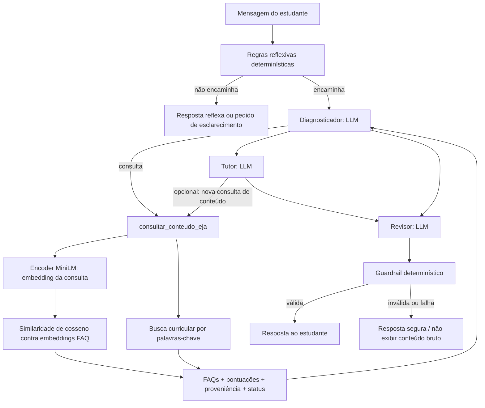

# Arquitetura técnica da rede neural, dos agentes e do RAG

Este documento descreve como o encoder neural representa consultas e FAQs, como o
retriever seleciona referências e como o CrewAI as entrega aos agentes que
diagnosticam, ensinam e revisam a resposta. Distingue a rede de embeddings do LLM:
são modelos diferentes, com responsabilidades diferentes.

## Resumo

O fluxo atual é:

1. A base FAQ é validada e cada FAQ inteira é codificada pelo encoder neural.
2. A consulta é codificada pelo mesmo encoder; a similaridade de cosseno ranqueia
   as FAQs do corpus.
3. O retriever filtra por limiar e sinaliza empate/ambiguidade.
4. A ferramenta de conteúdo devolve resultados e fontes ao agente que a chamou.
5. O CrewAI passa pelo diagnóstico, orientação e revisão; os agentes de linguagem
   usam o contexto recuperado para formular uma resposta pedagógica.

O encoder **não gera respostas e não é treinado neste projeto**. A geração é feita
por outro modelo, o LLM dos agentes.

## Componentes

| Componente | Responsabilidade |
|---|---|
| [`data/faq/FAQ_CONSOLIDADO.md`](../data/faq/FAQ_CONSOLIDADO.md) | Base versionada; cada pergunta e resposta forma uma unidade FAQ com ID e metadados de origem. |
| [`src/calma_ai/knowledge/faqs.py`](../src/calma_ai/knowledge/faqs.py) | Faz parsing, valida os registros, carrega o modelo, cria embeddings e busca as FAQs semanticamente. |
| [`src/calma_ai/tools/conteudo.py`](../src/calma_ai/tools/conteudo.py) | Combina a busca curricular existente com a recuperação de FAQs e formata o resultado para os agentes. |
| [`src/calma_ai/config/tasks.yaml`](../src/calma_ai/config/tasks.yaml) | Orienta diagnóstico e tutoria sobre como usar as referências e como agir quando faltam ou são ambíguas. |
| [`src/calma_ai/config/agents.yaml`](../src/calma_ai/config/agents.yaml) | Define papéis, metas, LLM e limites de iteração dos agentes. |
| [`src/calma_ai/crew.py`](../src/calma_ai/crew.py) | Declara os agentes, ferramentas, sequência de tarefas e validação final determinística. |
| [`src/calma_ai/main.py`](../src/calma_ai/main.py) | Aplica a etapa reflexiva, inicia o CrewAI e só apresenta respostas validadas. |
| [`src/calma_ai/reflexo.py`](../src/calma_ai/reflexo.py) | Faz encaminhamento inicial por regras explícitas; não é uma rede neural nem um LLM. |
| [`src/calma_ai/models.py`](../src/calma_ai/models.py) | Define os modelos Pydantic usados nos resultados estruturados do diagnóstico e da revisão. |
| [`scripts/avaliar_faqs.py`](../scripts/avaliar_faqs.py) | Mede a recuperação e calibra limiar e margem de ambiguidade usando os dados de validação. |
| [`data/datasets/faq_qa/`](../data/datasets/faq_qa/) | Conjunto de avaliação separado da base de FAQs usada em produção. |

## Base de conhecimento

A base padrão contém 203 FAQs. O parser identifica cada pergunta, resposta e os
metadados necessários:

- ID único;
- tema;
- fonte;
- nome do PDF;
- páginas ou slides;
- origem do material.

Cada FAQ é indexada como uma unidade completa. Não há chunking ou overlap: perguntas,
respostas e seus metadados pertencem ao mesmo registro. O texto entregue ao modelo
para criar o embedding de cada FAQ é composto por:

```text
Pergunta: <pergunta>
Resposta: <resposta>
Tema: <tema>
Material: <nome do documento>
```

Fonte, PDF, páginas e origem são preservados para referência, mas não entram no
texto usado para calcular o embedding.

O parser falha explicitamente se a base estiver vazia, uma resposta ou metadado
obrigatório estiver ausente, ou houver IDs duplicados. O arquivo padrão pode ser
substituído com `CALMA_FAQ_PATH`.

## Modelo e representação vetorial

O modelo padrão é
[`sentence-transformers/paraphrase-multilingual-MiniLM-L12-v2`](https://huggingface.co/sentence-transformers/paraphrase-multilingual-MiniLM-L12-v2).
É um modelo multilíngue pré-treinado usado para representar frases em português e
comparar seus significados. Ele não é o BERT português `neuralmind/bert-base-portuguese-cased`
e não foi treinado ou fine-tuned neste projeto.

O artefato do modelo carregado neste workspace contém um encoder Transformer
baseado em BERT com 12 camadas, 12 cabeças de atenção e dimensão oculta de 384.
O artefato usa vocabulário de 250.037 tokens, e o pipeline Sentence Transformers
configura comprimento máximo de sequência de 128 tokens. O Sentence Transformers
acrescenta um módulo de pooling por média dos tokens; assim, a arquitetura usada
para recuperação não é somente o Transformer bruto. Esses detalhes descrevem o
artefato atual; trocar `CALMA_EMBEDDING_MODEL` pode alterar arquitetura e propriedades.

### Como o encoder transforma texto em vetor

Para criar uma representação de frase, o modelo executa aproximadamente estas
etapas:

1. **Tokenização:** o texto é dividido em tokens/subpalavras e recebe tokens
   especiais do modelo. O artefato atual aceita até 128 tokens por sequência;
   sequências maiores são truncadas pelo pipeline do Transformer.
2. **Representação contextual:** os tokens passam pelas camadas Transformer.
   Em cada cabeça de autoatenção, projeções de consulta (`Q`), chave (`K`) e valor
   (`V`) relacionam tokens da sequência; de forma simplificada:

   ```text
   Attention(Q, K, V) = softmax(Q Kᵀ / √dₖ) V
   ```

   A autoatenção permite que a representação de cada token dependa dos demais
   tokens da sequência. As várias cabeças aprendem relações contextuais diferentes;
   camadas sucessivas transformam essas representações.
3. **Pooling:** o módulo Sentence Transformers calcula a média dos vetores dos
   tokens válidos, gerando um único vetor de dimensão 384 para a sequência.
4. **Normalização:** o código normaliza o vetor para comprimento unitário antes
   de compará-lo.

O resultado é um embedding denso: neste artefato, um vetor de 384 números que
representa a sequência em um espaço vetorial aprendido no pré-treinamento. Não
existe interpretação direta de cada dimensão, nem o vetor é uma probabilidade de
relevância. O espaço vetorial foi aprendido no treinamento multilíngue original do
modelo. O retriever depende da propriedade de que sequências semanticamente
relacionadas tendem a ficar próximas nesse espaço, mas isso não garante que toda
consulta do domínio EJA será representada corretamente.

Na consulta, o texto original da pergunta é codificado. No corpus, é codificado o
texto composto pelos campos pergunta, resposta, tema e nome do material descritos
acima. O mesmo encoder e o mesmo pooling são usados nos dois lados; não há encoder
separado para consultas e documentos, prefixos especiais de consulta ou expansão
automática da pergunta. A representação da FAQ pode, portanto, receber influência
da resposta e do nome do material, e não apenas da pergunta.

O código chama `SentenceTransformer.encode` em lotes de até 32 textos, com
normalização e conversão para NumPy `float32`. As similaridades são calculadas por
produto escalar:

```text
similaridade(consulta, FAQ) = embedding_consulta · embedding_FAQ
```

Como os vetores estão normalizados, esse produto escalar corresponde à similaridade
de cosseno. Para uma matriz de embeddings normalizados de FAQs `D` e um embedding
de consulta `q`, o código calcula `scores = q · Dᵀ` e ordena esse vetor de
pontuações. A pontuação é uma medida geométrica de proximidade, não uma confiança
calibrada: por exemplo, `0.8` não significa “80% de chance de estar correto”. O
limiar de `0.625` é uma regra de aceitação ajustada empiricamente no conjunto de
validação deste corpus.

### Inferência, não treinamento

O modelo é usado somente em inferência para codificar textos. O processo não
calcula gradientes, não altera os pesos e não aprende com as interações dos
estudantes. A chamada de `scripts/avaliar_faqs.py` também não treina o encoder: ela
compara resultados às FAQs esperadas e escolhe os limiares no conjunto `val`.

O LLM dos agentes é outro componente. Ele recebe o resultado da ferramenta e
redige a resposta pedagógica. O modelo de embeddings apenas mede proximidade entre
consulta e FAQ; não responde ao estudante, não resume o material e não verifica
por conta própria a verdade factual de uma resposta.

## Busca e critérios de aceitação

`search_faqs` faz uma busca para uma consulta; `search_many_faqs` processa várias
consultas em lote. O retriever:

1. codifica consultas não vazias;
2. compara cada vetor de consulta com todos os vetores FAQ;
3. ordena as FAQs pela similaridade;
4. considera até três resultados por padrão;
5. só inclui resultados com similaridade positiva e igual ou superior ao limiar.

Configuração padrão:

| Parâmetro | Padrão | Efeito |
|---|---:|---|
| Similaridade mínima (`CALMA_FAQ_MIN_SIMILARITY`) | `0.625` | Resultados abaixo do valor não são retornados. |
| Margem de ambiguidade (`CALMA_FAQ_AMBIGUITY_MARGIN_RATIO`) | `0.0` | Com o valor atual, os dois primeiros resultados só são marcados ambíguos quando empatam na pontuação. |
| Limite de resultados (`limit`) | `3` | Máximo de FAQs retornadas por consulta. |

O indicador de ambiguidade não apaga os resultados: ele acompanha as referências
para que a ferramenta e o agente saibam que devem pedir mais contexto. Na avaliação,
uma consulta ambígua é tratada como não aceita para calcular as métricas.

Para os dois primeiros resultados já aceitos pelo limiar, com pontuações `s₁` e
`s₂`, a regra é:

```text
ambígua = (s₁ - s₂) <= s₁ × margem_de_ambiguidade
```

Assim, margem `0.0` significa empate exato entre os dois primeiros resultados
(considerando a precisão numérica usada no cálculo), e não “sem possibilidade de
ambiguidade”. Uma margem positiva marca como ambíguos resultados próximos.

Os limiares podem ser substituídos por variáveis de ambiente. Valores inválidos ou
fora do intervalo aceito provocam erro explícito, em vez de serem ignorados.

## Índice vetorial e ciclo de vida

O índice é exato: guarda um embedding por FAQ e compara a consulta com todos eles,
sem FAISS, banco vetorial ou aproximação. O modelo e o índice são carregados sob
demanda e mantidos em cache durante o processo; o índice é reconstruído se caminho,
data de modificação, tamanho da base ou nome do modelo mudar. Os pesos ficam no
cache local do Hugging Face. `HF_HUB_CACHE`, `HF_HOME` e `CALMA_EMBEDDING_MODEL`
controlam o local do cache e o modelo. Os vetores não são persistidos como arquivos
de índice pelo projeto.

## Integração com o tutor

A ferramenta `consultar_conteudo_eja` executa duas buscas complementares:

1. `buscar_topico` procura tópicos e palavras-chave na base pedagógica
   `conteudos.json` usando correspondência textual normalizada.
2. `search_faqs` busca semanticamente na base consolidada de FAQs.

Portanto, nem toda a recuperação do sistema é neural: a busca curricular permanece
separada e baseada em palavras-chave; a recuperação neural é usada para as FAQs.
Os dois resultados podem aparecer juntos na resposta da ferramenta.

Quando há FAQs, a ferramenta retorna ID, pergunta, resposta, tema, documento,
fonte, PDF, páginas, origem e pontuação de similaridade. Também informa o estado
da busca. As instruções em `tasks.yaml` determinam que:

- referências ambíguas devem levar a uma pergunta para distinguir os materiais;
- sem correspondência, o agente não deve inventar fatos nem matéria;
- informações sobre materiais devem se apoiar nas referências retornadas.

Se a base FAQ não existir, a ferramenta registra um aviso e informa
`status_faq=indisponivel`; a busca curricular continua disponível. Erros de parsing,
configuração ou carregamento do modelo não são convertidos em uma busca lexical
silenciosa.

### Fluxo de uma consulta ponta a ponta

```text
Pergunta do estudante
        |
        v
Agente chama consultar_conteudo_eja(consulta)
        |
        +--> buscar_topico: palavras-chave na base curricular
        |
        +--> search_faqs: embedding da consulta
                 |
                 +--> similaridade contra embeddings das FAQs
                 +--> limiar, ranking e sinalização de ambiguidade
        |
        v
Tool devolve tópico + FAQs/fontes/status como contexto ao agente
        |
        v
LLM do agente formula a resposta usando as instruções pedagógicas
```

Esse é o ciclo RAG do projeto: **retrieval** seleciona referências da base,
**augmentation** torna essas referências e metadados disponíveis ao agente, e
**generation** é feita pelo LLM do CrewAI. Não existe um prompt independente que
injeta a base inteira; o agente recebe os resultados produzidos pela ferramenta.
As instruções de grounding reduzem invenções, mas não são uma prova formal de que
toda resposta gerada esteja correta.

## Agentes e orquestração do RAG

O RAG está inserido em uma equipe de agentes; não é uma chamada isolada do
Sentence Transformers. A sequência executada é `Process.sequential` no CrewAI.
Os três agentes de linguagem estão configurados para `ollama/llama3.2`. Esse LLM
é responsável por raciocínio e geração; o encoder MiniLM é usado somente pela
recuperação de FAQs.

Antes do CrewAI, `main.processar_turno` executa `reflexo.decidir`. Essa etapa é
determinística: normaliza a mensagem e avalia regras condition-action de
encaminhamento. Saudações, mensagens vazias e certos casos tratados diretamente
podem não chamar a equipe. Quando encaminha, a decisão reflexiva e a mensagem
reflexa são incluídas nos inputs do CrewAI; a etapa não usa o LLM.

| Ordem | Agente/tarefa | Papel no fluxo e acesso a ferramentas |
|---:|---|---|
| 1 | `diagnosticador` / `diagnosticar` | Recebe pergunta e contexto, consulta histórico do estudante, chama `consultar_conteudo_eja`, usa a calculadora para verificar contas e produz um diagnóstico estruturado (`Diagnostico`) com ação pedagógica e resposta esperada. |
| 2 | `tutor` / `orientar` | Recebe a saída do diagnóstico como contexto, executa a ação escolhida e redige a próxima etapa socrática. Também pode chamar `consultar_conteudo_eja`, por exemplo para localizar exercício do mesmo tema. Produz a mensagem ao estudante. |
| 3 | `revisor` / `revisar` | Recebe diagnóstico e mensagem do tutor. Revê tom, formato e vazamento da resposta final; devolve `RespostaRevisada`. |

O diagnóstico e a orientação são tarefas distintas: a primeira seleciona uma ação
(`fazer_pergunta`, `dar_dica`, `validar_e_avancar` ou `propor_exercicio`); a segunda
deve seguir essa ação e trabalhar um passo por turno. O histórico e a calculadora
são ferramentas auxiliares; não são componentes do encoder ou do índice vetorial.

### Como o resultado recuperado condiciona a resposta

1. Durante o diagnóstico, o agente chama a ferramenta com a dúvida do estudante.
2. A ferramenta devolve o tópico curricular e, se aplicável, as FAQs ranqueadas
   com resposta e proveniência. A pontuação permite ordenar, mas não é enviada como
   probabilidade ou prova de verdade.
3. O conteúdo retornado passa a compor o contexto da tarefa do agente. As
   instruções em `tasks.yaml` dizem para usar `tema`, `resposta` e `fonte` para
   identificar materiais, e para não inferir conteúdo quando não houver FAQ.
4. A tarefa `orientar` recebe o diagnóstico anterior como contexto CrewAI. O tutor
   pode consultar a ferramenta novamente; quando descreve material, deve se limitar
   às referências retornadas.
5. O revisor verifica a mensagem. Além da revisão por LLM, há um guardrail
   determinístico que compara com a resposta esperada do diagnóstico, detecta
   vazamento textual/numérico, bloqueia contas já resolvidas e exige pergunta
   orientadora e limite de tamanho. O CrewAI pode solicitar até duas revisões da
   tarefa quando esse guardrail reprova a saída.
6. `main.py` valida os tipos das saídas e executa novamente o guardrail antes de
   exibir a mensagem. Falha de execução ou formato leva a uma resposta segura, não
   à exibição de `resultado.raw`.

O guardrail é uma camada de validação da resposta do tutor, não parte da rede neural
de embeddings nem um classificador treinado. Ele não altera os vetores ou os pesos.



## Avaliação e calibração

O script [`scripts/avaliar_faqs.py`](../scripts/avaliar_faqs.py) lê os arquivos
`train`, `val` e `test` de `data/datasets/faq_qa`. O conjunto não treina nem ajusta
os pesos do modelo. Ele é usado para avaliar a recuperação e escolher os limiares.
O dataset contém 640 exemplos em `train`, 136 em `val` e 132 em `test`.

### Semântica dos rótulos

- `meta.id` identifica a FAQ esperada para recuperação. Se o ID existe na base FAQ,
  ele é alvo de recuperação tanto em exemplos `positivo` quanto `negativo`.
- `meta.tipo` indica se a resposta está apoiada pelo contexto fornecido no exemplo.
  Não é um rótulo de relevância para a busca na base FAQ completa.
- IDs ausentes da base não podem ser recuperados; o script os contabiliza à parte
  como alvos fora do corpus e observa se o sistema se abstém.

O script mede precisão, recall e F1 da recuperação do primeiro resultado (`P@1`,
`R@1`, `F1@1`). Os limiares são calibrados somente em `val`; `test` é reservado
para avaliação final. Como o dataset não tem rótulo específico de ambiguidade, a
margem é calibrada indiretamente pela métrica F1 da aceitação/abstenção.

A calibração testa valores de limiar e margem em passos de `0.025`. A escolha
prioriza F1 e depois precisão; em empate, favorece o limiar e a margem maiores.
As métricas não medem qualidade da resposta gerada pelo LLM, fundamentação textual
da resposta, latência ou experiência pedagógica. `P@1`/`R@1`/`F1@1` dizem respeito
à recuperação do primeiro resultado e aos IDs de FAQ existentes no corpus.

### Última avaliação registrada

Com a base, o dataset e a versão do modelo presentes neste workspace, a calibração
em `val` escolheu:

- similaridade mínima: `0.625`;
- margem de ambiguidade: `0.000`.

Resultados reportados pelo script:

| Split | P@1 | R@1 | F1@1 | TP | FP | FN | Alvos fora da base |
|---|---:|---:|---:|---:|---:|---:|---:|
| `train` | 0.991 | 0.969 | 0.980 | 554 | 5 | 18 | 68 |
| `val` | 1.000 | 1.000 | 1.000 | 120 | 0 | 0 | 16 |
| `test` | 1.000 | 0.917 | 0.957 | 110 | 0 | 10 | 12 |

Esses números descrevem a avaliação registrada, não uma garantia de qualidade
para toda consulta real. A margem zero significa que, no estado atual, somente
empates entre os dois primeiros resultados são tratados como ambiguidade.
Reexecute a avaliação se a base, o modelo ou o conjunto de dados mudar.

Para executar:

```powershell
uv run python scripts/avaliar_faqs.py
```

O script também aceita `--dataset-dir` e `--faq-path` para apontar para outras
localizações.

## Como evoluir o retriever

As seguintes ações são possibilidades futuras, não capacidades já implementadas:

1. **Analisar erros:** revisar os 10 falsos negativos do `test` e descobrir se
   decorrem de paráfrases, FAQ ausente, resposta longa, tema incorreto ou limiar.
2. **Avaliar perguntas reais:** construir consultas representativas da linguagem
   dos estudantes, incluindo sinônimos, erros ortográficos, perguntas curtas,
   ambiguidades e perguntas sem resposta na base.
3. **Comparar representações:** medir pergunta+resposta+tema contra pergunta+tema,
   ou manter vetores separados para pergunta e resposta. Isso verifica se respostas
   longas ou nome do material desviam a busca.
4. **Comparar encoders:** executar os mesmos dados e critérios em outros modelos
   multilíngues, comparando recuperação, abstenção e latência. Uma troca de modelo
   exige reconstruir o índice e recalibrar o limiar.
5. **Fine-tuning contrastivo, se houver dados suficientes:** pares de perguntas
   reais e FAQs corretas podem ensinar o encoder a aproximar consultas da FAQ
   relevante; FAQs próximas mas incorretas servem como hard negatives. O ajuste
   deve usar somente treino, com validação para decisões e teste intocado. As
   partições também devem evitar que paráfrases ou a mesma pergunta apareçam em
   mais de um conjunto.
6. **Rotular ambiguidade e abstenção:** adicionar exemplos que indiquem quando
   duas FAQs são respostas igualmente plausíveis e quando nenhuma FAQ serve. Isso
   permite calibrar a margem com rótulos diretos, em vez de usar F1 como aproximação.
7. **Evoluir o índice se o corpus mudar de escala:** avaliar persistência e busca
   aproximada somente se a comparação exata deixar de atender ao uso real.

O critério para escolher uma melhoria deve incluir recuperação, abstenção,
latência e qualidade das respostas apoiadas nas referências. Um modelo maior ou
fine-tuned não é automaticamente melhor: precisa superar o baseline em consultas
que representem o uso real.

## O que o RAG não faz atualmente

- Não treina nem faz fine-tuning do modelo de embeddings.
- Não gera resposta; essa responsabilidade continua com o LLM dos agentes.
- Não usa o dataset `faq_qa` como base de conhecimento do estudante.
- Não faz chunking, busca híbrida lexical-vetorial das FAQs ou reranking por outro
  modelo.
- Não altera nem valida o conteúdo didático original na hora da consulta.
- Não garante que uma similaridade alta seja prova de correção factual; o agente
  ainda precisa se apoiar no conteúdo recuperado e nas referências.

## Arquivos relacionados

- [`src/calma_ai/knowledge/faqs.py`](../src/calma_ai/knowledge/faqs.py): parser e
  retriever neural.
- [`src/calma_ai/tools/conteudo.py`](../src/calma_ai/tools/conteudo.py):
  integração do retriever com o CrewAI.
- [`src/calma_ai/config/tasks.yaml`](../src/calma_ai/config/tasks.yaml): instruções
  de uso das referências FAQ pelos agentes.
- [`data/faq/FAQ_CONSOLIDADO.md`](../data/faq/FAQ_CONSOLIDADO.md): corpus de
  produção versionado.
- [`data/datasets/faq_qa/`](../data/datasets/faq_qa/): dados de avaliação.
- [`scripts/avaliar_faqs.py`](../scripts/avaliar_faqs.py): avaliação e calibração.
